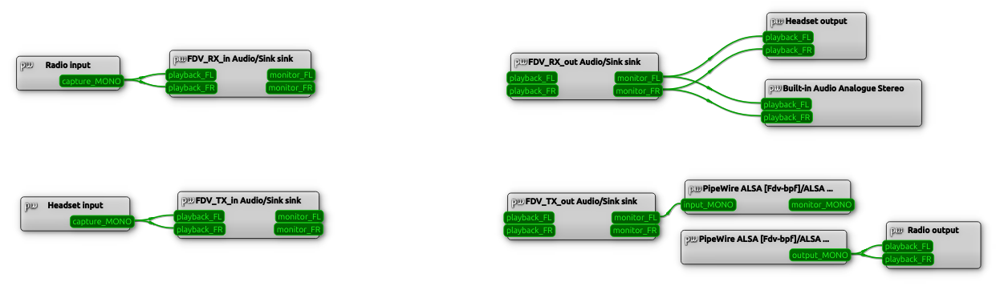
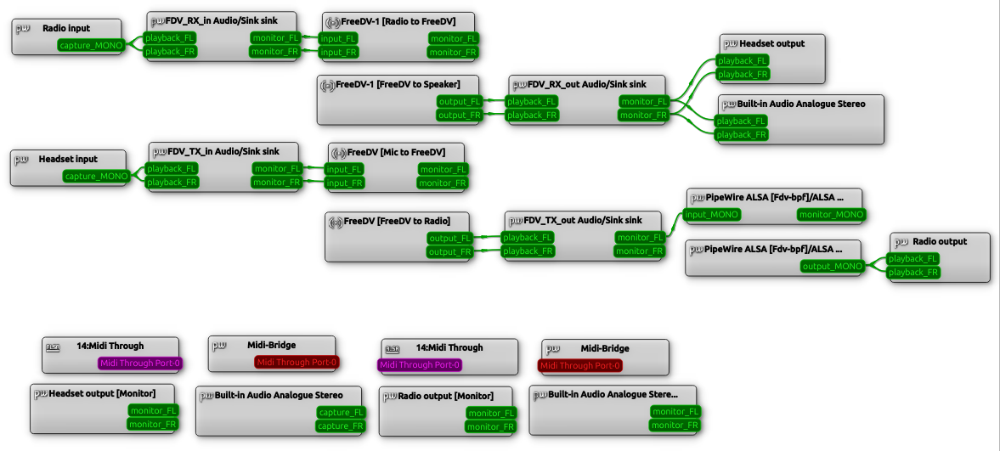
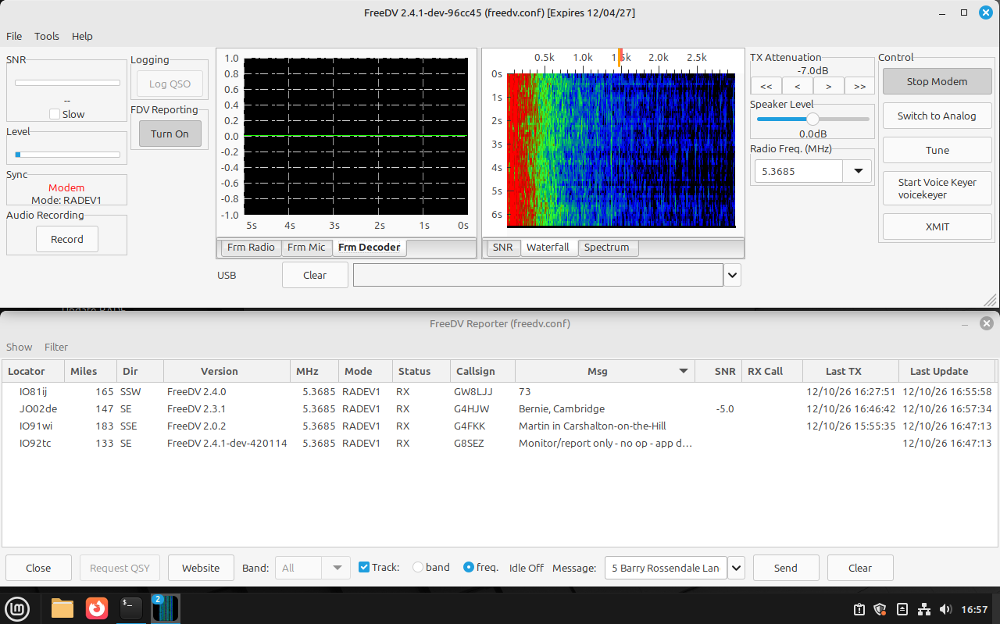

# freedv-rade-setup (test version)

freedv-rade-setup sets up the sound routing and rig control for FreeDV on a
Linux PC that already has FreeDV installed with **freedv-rade-build**. It
asks simple questions; if you're not sure, press Enter for the recommended
answer.

It makes, for one radio:

- the four FreeDV "virtual cables" (null sinks) and the links between them,
  your radio's sound card and your headset/speakers,
- fixed names for your USB sound cards (they stay the same after a reboot),
- rig control through Hamlib's rigctld (CAT and PTT),
- an optional transmit band-pass filter,
- if kiwiclient's kiwipanadapter is installed, optionally starting it (a
  KiwiSDR waterfall) together with FreeDV,
- a start script, a desktop icon ("FreeDV", or "FreeDV radio *name*" once
  there is more than one radio) and a FreeDV
  configuration just for this radio. Your existing FreeDV settings and start
  scripts are not changed.

**This is a test version.** Please send any problems, with the log file
(see below), to G4MKT.

## Before you start

- If this PC matters to you, take a backup or system snapshot first (on
  Linux Mint: Timeshift). On a spare test machine that's not needed.
- FreeDV needs **PipeWire**. If your PC still uses PulseAudio, the setup
  will offer to switch it to PipeWire. It shows you the commands to undo the
  switch *before* asking, and saves them in
  `~/.config/freedv-rade-setup/undo-pipewire-switch.txt`. It only switches
  if you answer **y**.
- Have your radio connected and switched on, and know which USB sound card
  is the radio's and which is your headset's.

## Running it

Start **freedv-rade-update** as usual (its desktop icon or
`~/freedv-rade-build/freedv-rade-update`) and choose **(A)udio & radio
setup** from the first menu. That also brings freedv-rade-setup up to date.

Or in a terminal:

    cd ~/freedv-rade-build
    ./freedv-rade-setup --check     # only checks your system (fixes are offered, each with a question)
    ./freedv-rade-setup             # the full setup

When it asks you to plug a USB sound card in, plug it into the socket it
will **always** stay in: its fixed name belongs to that socket.

At the end it offers a test: it links your radio, headset and filter to
FreeDV's FDV_ boxes and shows them in **qpwgraph**, then tidies up again.
FreeDV itself isn't shown in the test. Its own links to the FDV_ boxes
appear only when FreeDV is running and you press **Start Modem**.
Changes you make in qpwgraph only last for now: each time you start FreeDV
for this radio, its links are set up again from a saved list. If you change
any links during the test and want to keep them, type **S** then Enter at the
last question to save them to that list.

When qpwgraph first opens, the boxes are piled on top of each other and the
links look like a heap of spaghetti. Click and drag the boxes apart until they
look like the picture below. Drag any boxes that have no links (other sound
cards, other programs) to the bottom, out of the way. qpwgraph remembers where
you put them, so you only need to do this once.

This is how it should look without FreeDV running (the test, or before you
press Start Modem):

- Left: **Radio input** feeds FDV_RX_in, and **Headset input** (your
  microphone) feeds FDV_TX_in.
- Right: FDV_RX_out feeds your **Headset output** (here also the PC's
  speakers, because both were chosen), and FDV_TX_out goes through the
  transmit filter (the two "Fdv-bpf" boxes, labelled with its passband) to
  **Radio output**.
- The speakers box is named after your PC's sound card. If you chose no
  filter there are no Fdv-bpf boxes, and FDV_TX_out links straight to Radio
  output.

With FreeDV running and **Start Modem** pressed, FreeDV's own four boxes
appear between the FDV_ boxes:

- Receive (top): FDV_RX_in → **FreeDV [Radio to FreeDV]**, and
  **FreeDV [FreeDV to Speaker]** → FDV_RX_out.
- Transmit (lower): FDV_TX_in → **FreeDV [Mic to FreeDV]**, and
  **FreeDV [FreeDV to Radio]** → FDV_TX_out.
- The boxes along the bottom aren't used by FreeDV (MIDI, the cards'
  "[Monitor]" outputs, the PC's built-in input), so they're moved out of
  the way there.

Running it again later lets you test or change a radio (sound card, headset,
rig control, filter), or set up another radio.

If you have more than one FreeDV build in slots (see `freedv-slot --help`, e.g. `v1`
for RADE V1 and `v2` for RADE V2), the setup makes one icon per slot for
the radio ("FreeDV v1", "FreeDV v2", or "FreeDV radio *name* v1" ... with
more than one radio); in a terminal use
`~/freedv-radio-name --slot v1`. Each slot keeps its own FreeDV settings for
the radio, `freedv-v1.conf`, `freedv-v2.conf` and so on, so things like the
TX level can differ. Each is copied from the radio's `freedv.conf` the first
time that slot starts, so check its TX level then. Running the setup again
keeps the sound, rig control and station settings the same in all of them,
and adds or removes icons to match the slots. Without slots there is one
icon and `freedv.conf`, as before.

## If something goes wrong

- Everything the setup did is logged in
  `~/freedv-rade-build/freedv-rade-setup.log` (the previous run is in
  `freedv-rade-setup.log.1`). Please send that file.
- To go back to PulseAudio, run the commands in
  `~/.config/freedv-rade-setup/undo-pipewire-switch.txt`, then reboot (or
  restore your snapshot, if you took one).
- If a script stops with "the sound server is stuck", reboot. This usually
  means a USB sound device dropped out while in use.

## What it looks like when it works

The whole Linux Mint 22.1 screen: FreeDV, started from the "FreeDV radio
*name*" icon, with **Start Modem** pressed and receiving RADE V1 on 60 m,
and FreeDV Reporter below it:

